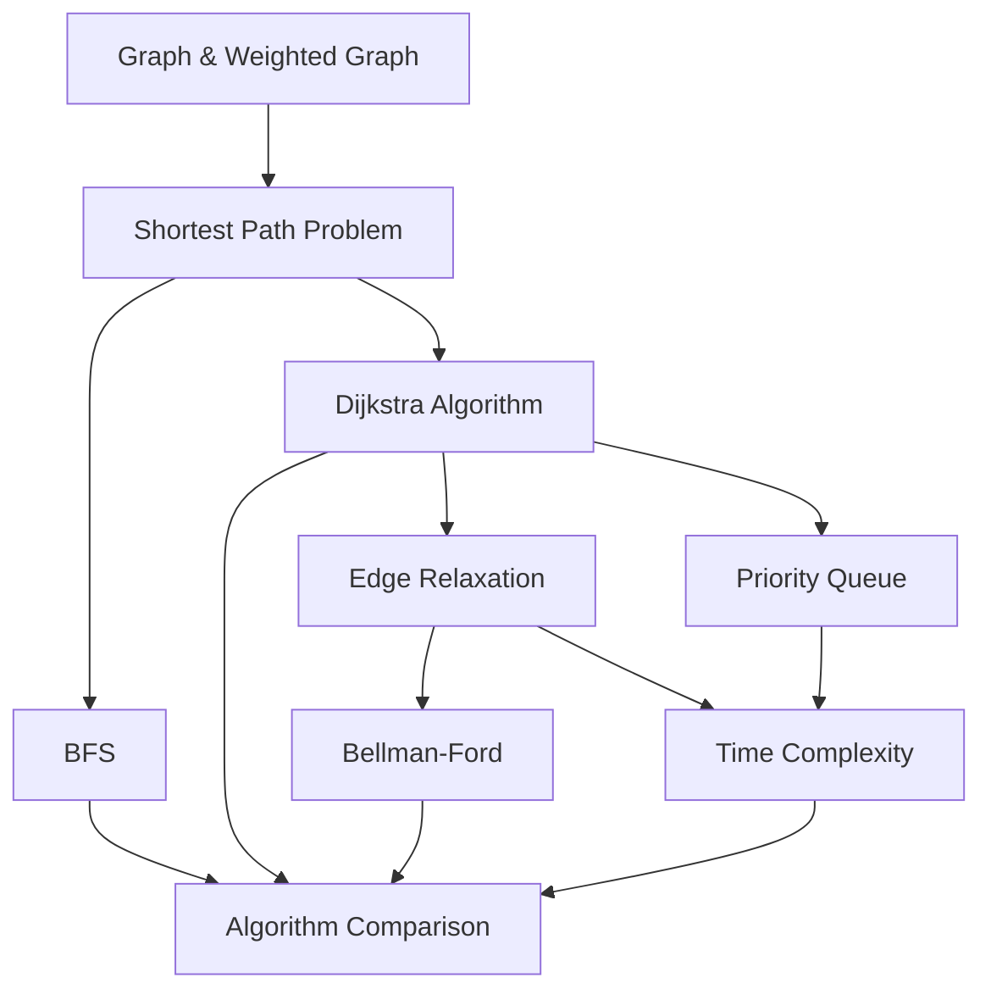

# 圖論與最短路徑演算法 — Wiki Overview

## 1. Wiki 介紹

本 Wiki 的主題是 **圖論與最短路徑演算法（Graph Theory & Shortest Path Algorithms）**，目標是讓沒有學過圖論演算法的讀者，也能從基本概念開始，逐步理解 Dijkstra 最短路徑演算法。

整套知識庫以一個問題為主軸：

> 給定一張由頂點與邊組成的圖，如何從指定起點出發，找到到其他頂點的最低成本路徑？

Wiki 會先介紹圖、邊與權重，再解釋最短路徑問題，接著深入 Dijkstra 的貪婪策略、優先佇列與鬆弛操作，最後比較 BFS、Dijkstra 與 Bellman-Ford 的差異。

## 2. 學習目標

完成本 Wiki 的閱讀後，讀者應能：

1. 說明 Graph、Vertex、Edge、Weighted Graph、有向圖與無向圖。
2. 分辨非加權圖的「最少邊數」與加權圖的「最低總權重」。
3. 說明 BFS、Dijkstra、Bellman-Ford 分別適合什麼情況。
4. 解釋 Dijkstra 的 Greedy Strategy、Frontier、Settled 與非負權重限制。
5. 使用 Edge Relaxation 更新距離，並以 `prev` 還原路徑。
6. 說明 Priority Queue 為何能協助 Dijkstra 選擇目前距離最小的頂點。
7. 比較三種演算法的時間複雜度及空間需求。

## 3. 建議閱讀順序

如果是第一次接觸圖論演算法，建議依照以下順序閱讀：

### 第一階段：認識圖與問題

1. [[02-graph-weighted-graph|Graph & Weighted Graph]]：認識頂點、邊、方向、權重與圖的表示法。
2. [[03-shortest-path-problem|Shortest Path Problem]]：理解最短路徑、路徑成本與單源／單點／全點對查詢。

### 第二階段：理解 Dijkstra 的核心

3. [[04-dijkstra-algorithm|Dijkstra Algorithm]]：學習 Dijkstra 的適用條件、貪婪選擇、執行範例與路徑還原。
4. [[05-edge-relaxation|Edge Relaxation]]：理解候選距離如何比較，以及 `dist`、`prev` 如何更新。
5. [[06-priority-queue|Priority Queue]]：理解 Min Heap、Extract-Min 與優先權更新。
6. [[07-time-complexity|Time Complexity]]：分析 BFS、Dijkstra、Bellman-Ford 的時間與空間成本。

### 第三階段：比較其他方法

7. [[08-bfs|BFS]]：理解如何以 FIFO Queue 逐層找出非加權圖的最少邊數路徑。
8. [[09-bellman-ford|Bellman-Ford]]：理解負權重邊、反覆鬆弛與負權重環偵測。
9. [[10-algorithm-comparison|Algorithm Comparison]]：整理三種演算法的限制、策略與適用情境。

## 4. Wiki 知識架構

此圖呈現概念間的主要學習關係，不代表只有單向連結。每個知識頁面也會提供返回其他相關頁面的連結。

## 5. 三種核心演算法先看懂差異

| 演算法 | 適用情況 | 核心概念 |
|---|---|---|
| BFS | 非加權圖，或每條邊成本相同且非負 | FIFO Queue，逐層探索，找最少邊數 |
| Dijkstra | 所有邊權重皆非負 | 每輪選擇暫定距離最小的 Frontier 頂點 |
| Bellman-Ford | 可以有負權重邊 | 最多 \(V-1\) 輪反覆鬆弛所有邊，並檢查來源點可達的負環 |

若存在從來源點可達的負權重環，且該環可到達某個目標頂點，該目標便沒有有限最短路徑。三種方法的詳細比較請見 [[10-algorithm-comparison|Algorithm Comparison]]。

## 6. 核心名詞索引

| 名詞 | 簡要說明 | 詳細頁面 |
|---|---|---|
| Graph | 由頂點與邊構成的結構 | [[02-graph-weighted-graph|Graph & Weighted Graph]] |
| Weighted Graph | 邊帶有數值權重的圖 | [[02-graph-weighted-graph|Graph & Weighted Graph]] |
| Shortest Path | 路徑成本最低的路徑 | [[03-shortest-path-problem|Shortest Path Problem]] |
| Greedy Strategy | 每輪選擇目前看起來最好的候選 | [[04-dijkstra-algorithm|Dijkstra Algorithm]] |
| Edge Relaxation | 找到更短候選路徑時更新距離 | [[05-edge-relaxation|Edge Relaxation]] |
| Priority Queue | 依優先權取出元素的資料結構 | [[06-priority-queue|Priority Queue]] |
| Time Complexity | 描述執行成本隨輸入規模成長的方式 | [[07-time-complexity|Time Complexity]] |
| BFS | 廣度優先搜尋 | [[08-bfs|BFS]] |
| Bellman-Ford | 可處理負權重邊的單源最短路徑演算法 | [[09-bellman-ford|Bellman-Ford]] |

## 7. 資料來源與維護方式

本 Wiki 使用六組經過 Review 並獲核准的外部資料來源（R1–R6），包含 Cornell University 課程教材、NetworkX 官方文件與 MIT OpenCourseWare。每個知識頁的 `references` 中繼資料與正文參考資料會標記來源代號；來源細節集中記錄在 `sources/`。

每筆來源的維護流程為：

1. **Review**：閱讀外部資料，擷取重點並比對現有 Wiki。
2. **Approval**：確認擷取範圍、目標頁面與去重方式。
3. **Ingest**：新增頁面或整合既有頁面，保留來源資訊。
4. **Local Checks**：檢查中繼資料、內部連結、範例計算與內容一致性。

本專案目前以本地 Markdown 檔案維護，並非已連線至外部 LLM Wiki 平台。`local-check-report.md` 記錄本地檢查；若沒有外部 Wiki 引擎連線，就不會宣稱已執行該引擎的 Lint。

## 8. 來源清單

- **R1**：Cornell University, CS 2110, *21. Graphs*。<https://www.cs.cornell.edu/courses/cs2110/2026fa/lectures/lec21/>
- **R2**：NetworkX Developers, *Shortest Paths*, NetworkX 3.7 documentation。<https://networkx.org/documentation/stable/reference/algorithms/shortest_paths.html>
- **R3**：Cornell University, CS 2110, *23. Shortest Paths*, Fall 2026。<https://courses.cis.cornell.edu/courses/cs2110/2026fa/lectures/lec23/>
- **R4**：Cornell University, CS 2110, *18. Heaps and Priority Queues*, Fall 2026。<https://www.cs.cornell.edu/courses/cs2110/2026fa/lectures/lec18/>
- **R5**：MIT 6.006, *Lecture 12 / Recitation 12: Bellman-Ford*。<https://ocw.mit.edu/courses/6-006-introduction-to-algorithms-spring-2020/>
- **R6**：Cornell University, CS 312, *Lecture 26: Finding Shortest Paths*。<https://www.cs.cornell.edu/courses/cs312/2007sp/lectures/lec26.html>

## 9. 建議的下一步

如果想用 Wiki 製作教學 HTML 簡報，可以先閱讀本 Overview，再以 `Dijkstra Algorithm` 作為簡報主軸，從 `Graph & Weighted Graph`、`Shortest Path Problem`、`Edge Relaxation`、`Priority Queue` 擷取前置概念，最後使用 `Algorithm Comparison` 說明 BFS 與 Bellman-Ford 的差異。
