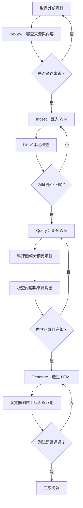

# Loop / Graph 設計與實作反思

## 1. 專案目標

本專案以「圖論與最短路徑演算法」為主題，建立 LLM Wiki 作為知識庫，再利用 Wiki 製作「從零理解 Dijkstra」教學型 HTML 簡報。流程包含外部資料取得、來源審查、Ingest、Wiki 檢查、Query、內容整理、HTML 生成與瀏覽器測試。

## 2. Workflow

## 3. 各階段工作

| 階段 | 執行內容 | 目的 |
|---|---|---|
| 取得資料 | 蒐集 Cornell、MIT、NetworkX 等課程教材及官方文件 | 建立可靠知識來源 |
| Review | 檢查來源可靠性、技術正確性及與既有 Wiki 的重複程度 | 避免錯誤或重複資訊進入 Wiki |
| Ingest | 將核准內容整理進知識頁，保留來源編號 | 建立可追溯的知識庫 |
| Wiki 檢查 | 檢查中繼資料、頁面連結、來源及範例 | 確保知識庫結構完整 |
| Query | 查詢 Dijkstra 教學需要的 Wiki 頁面 | 取得有依據的簡報素材 |
| 整理重點 | 安排學習順序、整理簡報大綱 | 讓初學者循序理解 |
| Generate | 依核准的大綱產生 HTML | 將 Wiki 知識轉成教學成果 |
| 瀏覽器測試 | 測試切換、全螢幕、進度條及響應式版面 | 確保簡報可正常使用 |

## 4. 會重複執行的 Loop

### 4.1 資料匯入 Loop

每篇外部資料先經過 Review，再與現有 Wiki 比對。若發現重複、矛盾或來源不足，就調整擷取範圍並重新審查；通過後才 Ingest。例：R3 與 R6 都介紹 Dijkstra，因此將 R6 的最短路徑樹與前驅性質補充到原有 Dijkstra 頁面，而不是建立重複頁面。

### 4.2 Wiki 查詢與內容整理 Loop

Query 後檢查簡報所需概念是否齊全、敘述是否有 Wiki 依據。若缺少知識或來源對應不清楚，就重新查詢相關頁面；必要時先補充 Wiki，再重新整理大綱。

### 4.3 HTML 生成與測試 Loop

產生 HTML 後以瀏覽器實際測試。若版面或互動出錯，就修改 HTML/CSS/JavaScript，再重新測試，直到符合需求。

## 5. 檢查點與失敗處理

| 檢查位置 | 檢查內容 | 未通過時的處理 |
|---|---|---|
| Ingest 前 | 來源可靠性、技術正確性、內容重複 | 重新擷取或更換資料 |
| Ingest 後 | 中繼資料、內部連結、來源紀錄、範例計算 | 修正 Wiki 並重跑檢查 |
| Generate 前 | 大綱完整性、技術敘述、Wiki 來源對照 | 重新 Query 並整理 |
| Generate 後 | HTML 載入、投影片切換、全螢幕、進度條、不同尺寸版面 | 修改 HTML 並重測 |

## 6. 實際執行與反思

### 6.1 最常出錯的節點

實際執行時，HTML Generate 與瀏覽器測試階段較容易出現問題。HTML 雖然能成功產生，但不同投影片的內容長度及版面結構不完全相同，可能造成個別頁面顯示異常。

例如，曾發現第 9 頁與第 11 頁進入全螢幕後，底部綠色進度條跑到畫面中間，造成版面錯位。

### 6.2 將檢查提前的位置

因此，在 HTML 生成後立即執行瀏覽器測試，並將全螢幕容器、底部進度條定位、投影片高度及不同螢幕尺寸列為固定檢查項目，而不是只確認 HTML 是否成功輸出。

### 6.3 Workflow 的修改

在 Generate 後明確增加「瀏覽器測試」節點。若測試未通過，返回 Generate 修改 CSS 或 JavaScript，再重新執行測試。修正後重新測試第 9、11 頁及不同視窗尺寸，確認顯示與操作正常。

這次經驗讓我了解，Workflow 不只要設計如何產生結果，也要設計如何驗證結果；實際執行發現問題時，應將新的檢查條件加入流程，讓後續成果更可靠。

## 7. 已知限制

本專案以本地 Markdown 檔案維護 Wiki，並執行本地結構與連結檢查；未連接外部 LLM Wiki 引擎，因此不宣稱已執行該引擎的 Lint。資料來源摘要、擷取範圍與 Review 紀錄保存在 `sources/`，完整 Ingest 紀錄保存在 `ingest-log.md`。
